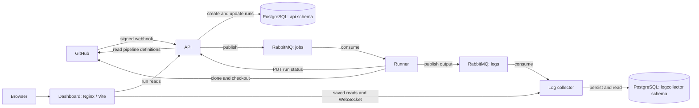

FlowForge is a webhook-driven CI/CD system with four separately deployed
application services. GitHub events initiate work, RabbitMQ distributes it,
PostgreSQL stores run history and logs, and the dashboard reads that stored state.

This guide describes the checked-in implementation. It does not imply delivery,
isolation, or deployment guarantees beyond what the code and manifests provide.

## System model

The two PostgreSQL schemas can share a database, as in local Compose, while
remaining owned by their respective services. The runner and dashboard do not
write to the database directly.

## Service responsibilities

| Service | Entry point | Owns | Communicates with |
| --- | --- | --- | --- |
| API | `cmd/api/main.go` | Webhook validation, pipeline discovery and matching, run history, lifecycle updates | GitHub, PostgreSQL, `jobs` queue |
| Runner | `cmd/runner/main.go` | Source checkout, shell execution, output publication, execution results | GitHub, API, `jobs` and `logs` queues |
| Log collector | `cmd/logcollector/main.go` | Saved log records and live notifications | PostgreSQL, `logs` queue, HTTP/WebSocket readers |
| Dashboard | `ui/src/main.ts` | Run navigation, filtering, rendering, log search and export | API and collector through its server-side proxy |

The API does not execute pipeline commands. The runner reports lifecycle changes
through the API's SDK. The collector stores logs independently of run status;
output can arrive after a run has been marked completed or failed.

## Code organization

| Path | Purpose |
| --- | --- |
| `api/gh/` | GitHub webhook handler, event matching, pipeline discovery |
| `api/pipelineruns/` | Run model and handler/service/repository layers |
| `api/sdk/` | HTTP client used by the runner to update runs |
| `runner/pipelines/` | Pipeline types, validation, variable substitution, execution |
| `runner/git/` | Clone and branch checkout commands |
| `runner/dirmanagement/` | Runner workspace paths and process working directory |
| `logcollector/` | Log model, repository, ingestion behavior, HTTP and WebSocket handling |
| `common/` | DTOs, database initialization, queue helpers, logging, environment loading |
| `ui/src/` | TypeScript dashboard, run/detail rendering, saved and live logs |
| `ui/tests/` | Isolated real-service Playwright journeys and configuration checks |
| `docker/` | Per-service images and Compose definitions |
| `kubernetes/kustomize/` | Kubernetes base, overlays, and KEDA runner component |

## State and communication

Run rows are the dashboard's source for lifecycle information. Saved log rows
are its source for output. A collector WebSocket frame contains message text,
without a persisted record ID; the dashboard uses it as a signal to fetch a new
snapshot. It also polls, so missed notifications can be recovered if the records
were persisted. The [execution walkthrough](/execution-flow) explains the
ordering and failure boundaries.

The API and log collector create their schemas and run GORM `AutoMigrate` at
startup. There is no versioned migration directory. Schema changes need review for
existing installations, not just a fresh database.

The queues are durable and publications use persistent delivery mode. Database
writes and broker publications are separate operations, with no transactional
outbox or publisher confirms. This is not an exactly-once execution system.

## Deployment models

**Local Compose:** Make targets compose the existing per-service files. The API
and collector share PostgreSQL and RabbitMQ. The UI publishes localhost port
3000 and proxies reads to service names on the Compose network. Vite provides
the same browser-facing routes during development on localhost port 5173.
See [local development](/development) for configuration and rebuild commands.

**Development server:** `docker/docker-compose.dev-server.yaml` combines the
services with a Traefik gateway and environment-specific host settings. It is a
separate deployment option, not a prerequisite for local dashboard development.

**Kubernetes:** the FlowForge overlay installs API, collector, PostgreSQL, and
RabbitMQ deployments plus a KEDA `ScaledJob` watching the `jobs` queue. Its
config sets `RUN_ONCE=true` for runner jobs. The checked-in overlay does not
deploy the dashboard. The manifests also need environment-specific review for
ingress, credentials, storage, and runner Docker access; they are not equivalent
to the local Compose setup. See the [Kubernetes guide](/kubernetes-setup).

## Trust boundaries

Pipeline steps run as shell processes inside the runner container. FlowForge
does not create a fresh container for each job or step. The local runner is
privileged and mounts the host Docker socket, giving pipeline commands access
to the host daemon. Only run code you trust on that host.

The backend run and log routes currently have no application authentication.
The collector's WebSocket origin check accepts any origin. The dashboard's
production proxy limits access to specific read routes, but it does not secure
direct access to the backend services. Network access control and TLS belong in
the deployment in front of these services.

The queued run metadata includes a VCS token. Private repository cloning embeds
it in a URL that is currently logged. Treat broker access, stored logs, exports,
and workspace contents as sensitive. The UI has no GitHub, database, or broker
credentials in its browser bundle.

Continue with the [data models](/data-model), [execution flow](/execution-flow),
[pipeline reference](/pipelines), or [dashboard behavior](/dashboard).
