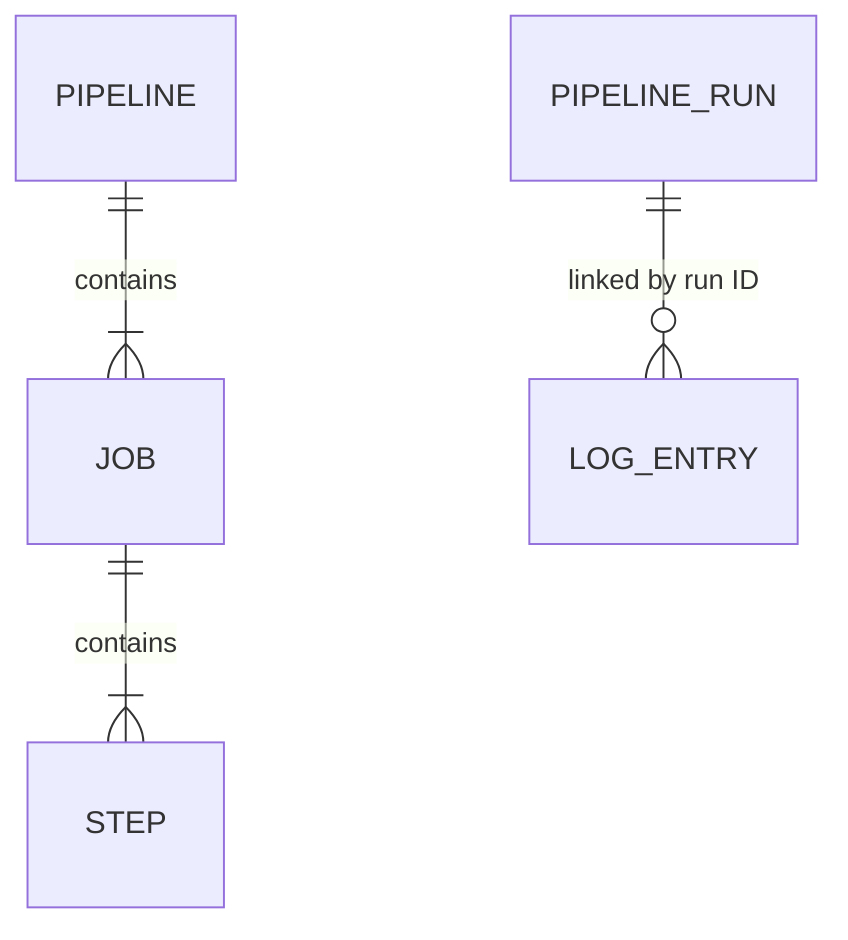

The [glossary](/glossary) defines the domain language. This page maps those
terms to Go structs, stored rows, and messages. JSON names and YAML names are
part of the current contracts, including their inconsistent casing.

## Relationships



The pipeline, jobs, and steps are configuration objects, not database tables.
The run-to-log relationship is logical: the services use matching run ID strings
without a database foreign key or cross-service join. Log records can therefore
exist for a run ID that is absent from run history.

## Pipeline configuration

Defined in [`runner/pipelines/types.go`](https://github.com/SpyrosMoux/cicd/blob/main/runner/pipelines/types.go):

| Type | YAML fields | Meaning |
| --- | --- | --- |
| `Pipeline` | `triggers`, `variables`, `jobs` | Repository-owned pipeline definition |
| `Triggers` | `branch`, `pr` | Pushed-branch and pull-request destination-branch matches |
| `Job` | `name`, `needs`, `steps` | Named group of sequential steps |
| `Step` | `name`, `run` | Named shell script |

There is no persisted job/step lifecycle model. `needs` is checked for references
to defined job names but does not determine execution order. See the
[pipeline reference](/pipelines) for a complete example and validation rules.

## Pipeline run

[`PipelineRun`](https://github.com/SpyrosMoux/cicd/blob/main/api/pipelineruns/types.go) is stored in
`api.pipeline_runs`. The API creates its UUID when a matching event is accepted.

| JSON field | Go type | Meaning |
| --- | --- | --- |
| `id` | `string` | Primary key; also the broker correlation ID |
| `status` | `string` | Recorded lifecycle status |
| `repository` | `string` | Repository name, without an owner field |
| `branch` | `string` | Branch/ref as recorded by the event handler |
| `error` | `string` | Recorded execution failure, or an empty string |
| `trigger_type` | `string` | `Push` or `Pull Request` |
| `triggered_by` | `string` | GitHub sender login |
| `time_triggered` | `int64` | Creation time in Unix seconds |
| `time_started` | `int64` | Reported execution start in Unix seconds; initially zero |
| `time_ended` | `int64` | Reported execution end in Unix seconds; initially zero |

Push runs currently record the webhook ref (such as `refs/heads/main`), while
pull-request runs record the head branch name. A run row does not store a commit
SHA, pipeline filename, pipeline name, job results, or the pipeline definition.
Multiple matching definitions produce separate run IDs, but history does not
identify which definition each used.

The known status strings are `Pending`, `Running`, `Canceled`, `Failed`, and
`Completed`. `Canceled` is modeled but there is no cancellation operation.
`PUT /app/cicd/api/runs/:id` accepts `status`, optional `error`, `time_started`,
and `time_ended`. Nonzero times replace the stored values; `error` is replaced
even when omitted and decoded as empty. The update service does not enforce a
state transition graph or use `ParseStatus` to validate incoming status strings.

## Queued run

[`PublishRunDto`](https://github.com/SpyrosMoux/cicd/blob/main/common/dto/publishrundto.go) is JSON on the `jobs` queue:

| JSON field | Representation | Meaning |
| --- | --- | --- |
| `pipelineAsBytes` | Base64 string | Go `[]byte` containing the marshaled pipeline YAML |
| `metadata.repository` | String | Repository name used for cloning |
| `metadata.branch` | String | Branch used for checkout |
| `metadata.repoOwner` | String | Repository owner used for cloning |
| `metadata.repoVisibility` | Integer | `0` public, `1` private |
| `metadata.vcsSource` | Integer | `0` GitHub |
| `metadata.vcsToken` | String | Token used for private clone access |

The run ID is carried by the AMQP `CorrelationId`, not a JSON body field. The
runner uses that ID for lifecycle requests and logs. Persisted run rows and queued
metadata are different models: the queue contains execution inputs and credentials
that the history API does not expose.

## Log ingestion and saved records

[`LogEntryDto`](https://github.com/SpyrosMoux/cicd/blob/main/common/dto/logentry_dto.go) is JSON on the `logs` queue. Its
fields are `runId`, `timestamp`, `logLevel`, and `message`, all strings.
The severity input accepts `INFO`, `WARN`, `ERROR`, and `DEBUG`.

The collector converts that DTO into
[`LogEntry`](https://github.com/SpyrosMoux/cicd/blob/main/logcollector/types.go), stored in `logcollector.log_entries`:

| JSON field | Stored type | Meaning |
| --- | --- | --- |
| `id` | String | UUID assigned by the collector |
| `runid` | String | Run ID; note the difference from ingestion's `runId` |
| `timestamp` | String | Producer-provided timestamp, not a sequence or database time |
| `logLevel` | Integer | Stored severity |
| `message` | String | Literal output, including repeated messages |

The current Go constant declaration assigns zero to all four collector severity
constants. New ingested records therefore lose severity distinctions. The UI
maps stored numbers as INFO=0, WARN=1, ERROR=2, DEBUG=3, and displays actual stored
values; it cannot recover the lost distinction.

The log repository does not order reads. The dashboard sorts by timestamp string,
then record ID, both ascending. This gives deterministic presentation without
claiming emission order. UUIDs are not stream offsets. A redelivered broker log
can receive a new persisted ID, so ID-based browser reconciliation does not
provide ingestion deduplication.

## HTTP and live reads

Backend run/log responses use [`ResponseDto`](https://github.com/SpyrosMoux/cicd/blob/main/common/dto/reponse_dto.go):

```json
{"status": 200, "message": "", "data": [], "error": ""}
```

| Backend route | Consumer and purpose |
| --- | --- |
| `POST /app/cicd/api/gh/webhook` | GitHub event ingress; uses its own response shape |
| `GET /app/cicd/api/runs` | Complete run history; no server-side filtering or pagination |
| `PUT /app/cicd/api/runs/:id` | Runner lifecycle update |
| `GET /app/cicd/logs/:runId` | Saved output for a run |
| `GET /app/cicd/logs/ws/:runId` | WebSocket upgrade; text notifications for newly saved output |
| `GET /app/cicd/api/health` | API liveness response |
| `GET /app/cicd/logs/health` | Collector liveness response |

There is no single-run GET route. The dashboard resolves a detail URL from the
loaded run list. Browser routes `/api/runs`, `/api/logs/:runId`, and
`/api/logs/ws/:runId` are proxy paths, not extra backend endpoints.
Health responses do not actively verify database or broker connectivity.
