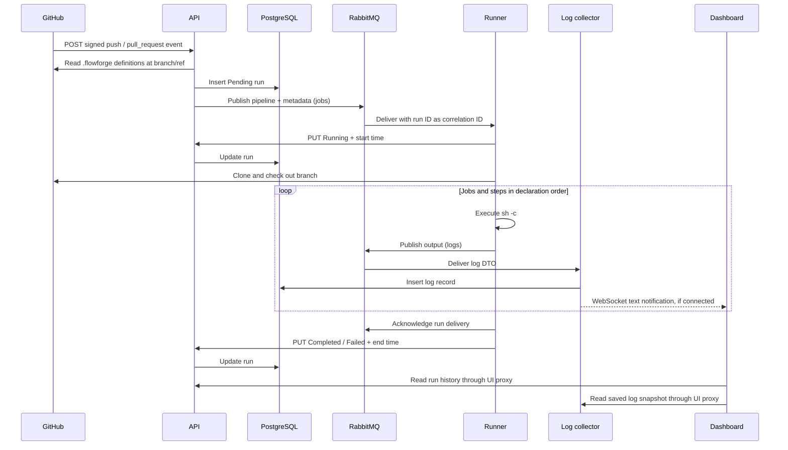
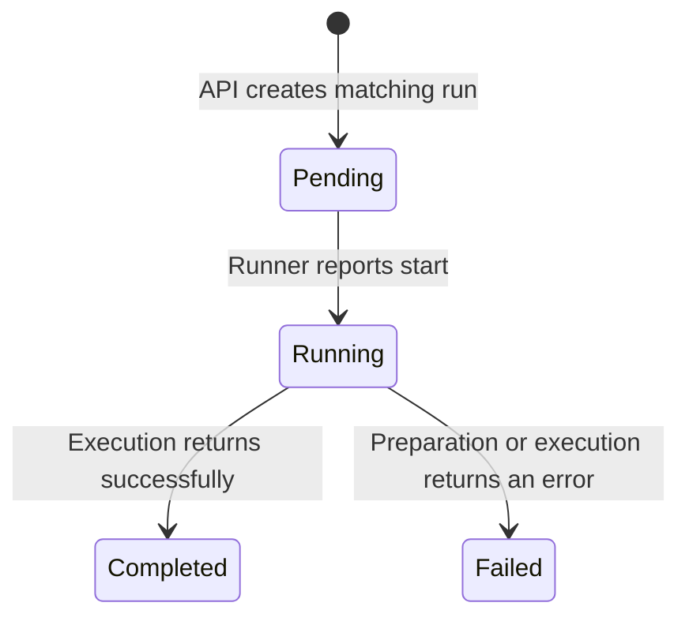

This walkthrough connects the [architecture](/architecture) and
[data models](/data-model) for one matching pipeline.

## The normal path

Database accesses in this diagram target each service's own schema. The two
broker queues are independent; the diagram does not impose an ordering between
the final status update and all log inserts.

1. The webhook handler validates the payload with `GH_WEBHOOK_SECRET` and parses
   the GitHub event type. The service supports push and pull-request events.
2. The API reads files from the repository's `.flowforge` directory, parses
   valid pipeline definitions, and matches their triggers. Each match creates
   its own `Pending` row before publishing execution inputs to `jobs`.
3. The runner consumes with prefetch one and handles deliveries serially. It
   reports `Running`, parses the queued definition, clones sources, and checks
   out the queued branch.
4. It substitutes variables and executes jobs and their steps sequentially.
   Output is published to `logs`. An execution error stops the remaining work;
   workspace cleanup is deferred.
5. The collector saves each incoming log, then broadcasts its message text to
   WebSocket clients connected to that collector process for the same run ID.
6. The runner acknowledges the work delivery and attempts to record `Completed`
   or `Failed` with an end time. With `RUN_ONCE=true`, the process then exits.
7. The dashboard polls run history and saved logs. Opening a live connection or
   receiving a frame requests another saved snapshot. It preserves persisted
   record identity rather than appending unidentifiable live text.

## Lifecycle model

This is the normal reporting path, not an API-enforced state machine. A failed
status request can leave stale history even when execution continues or finishes.
`Canceled` is a recognized status but has no implemented cancellation path.
Missing start/end times remain zero; the UI treats them as unavailable.

## Failure and recovery boundaries

| Boundary | Current behavior and implication |
| --- | --- |
| Run creation → publication | Separate database and broker operations. Publication errors are logged, not propagated by `PublishJob`; a run can remain Pending without queued work. |
| Runner execution → acknowledgement | A failed pipeline is also acknowledged. There is no automatic retry just because a step failed. An unacknowledged delivery can be redelivered after a consumer disconnects and execute again. |
| Acknowledgement → terminal update | The acknowledgement precedes the final HTTP update. Failure here can leave a run showing Running after its work has been consumed. |
| Log delivery → persistence | The consumer acknowledges after calling its ingestion function, including when that function returns early on malformed input. There is no explicit negative-acknowledgement/retry policy for failed ingestion. |
| Persistence → live notification | Notifications are process-local and contain only text. A disconnected client or a client on a different collector replica can miss them; polling can recover saved records. |
| Terminal status → final output | Logs arrive asynchronously and can be late. The dashboard continues reading saved output after terminal status. |
| Backend outage → dashboard | Run and log refreshes retain their last successful snapshots with stale warnings. A failed initial read is distinct from a successful empty history. |

Durable queues and persistent messages do not remove these boundaries. There is
no webhook-delivery deduplication, execution lease, automatic stale-run recovery,
or transaction spanning a run row and its message.

The collector's error-logging path also has an uninitialized service logger,
so some ingestion/database failures can panic rather than produce a useful error.
Do not assume every failed log is retained or retried.

## Tracing a problem

Use the run UUID to connect the API row, `jobs` correlation ID, runner messages,
and collector records. `Pending` points first toward publication, queue depth,
and runner availability. A stale `Running` row can indicate runner failure or a
failed status update. Missing logs require checking both publication and collector
persistence, not just the WebSocket. The [development guide](/development#troubleshooting)
lists local inspection commands.
